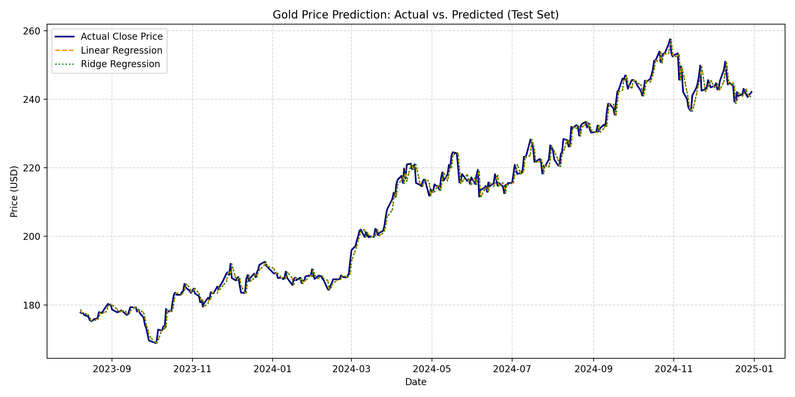
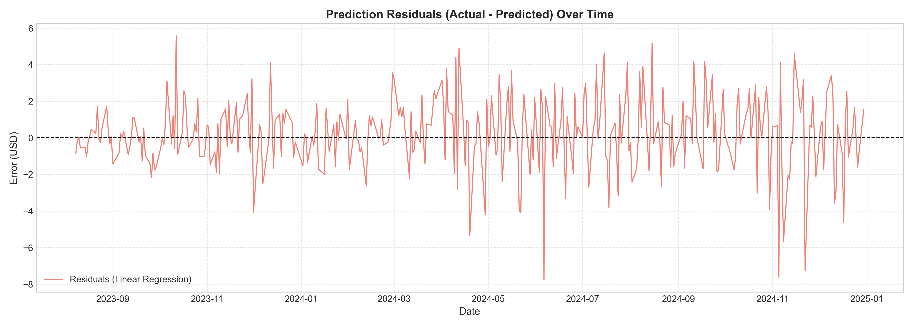

# Gold Price Prediction via Linear and Ridge Regression
### Urmia University — Deep Learning & Machine Learning Course (Assignment #1)

**Author:** Matin Sojoudi (متین سجودی) — Student ID: `14014421025`  
**Supervisor:** Dr. Saleh Yousefi  
**Term:** Autumn 2026 (پاییز ۱۴۰۵)  

---

## 📌 Project Overview
This repository contains the complete implementation, data preprocessing, machine learning models, and analytical report for **Assignment #1: Regression for Gold Price Prediction**.

The objective is to develop and evaluate **Linear Regression** and **Ridge Regression (L2 Regularization)** models to predict the next day's closing price of gold using historical daily market data from **SPDR Gold Shares (GLD)**.

---

## 📊 Dataset
* **Source:** SPDR Gold Shares (`GLD`) from Yahoo Finance
* **Time Range:** January 2, 2018 – December 31, 2024 (7 years of daily trading data)
* **Total Clean Samples:** 1,760 trading days
* **Features:** `Open`, `High`, `Low`, `Close`, `Volume`
* **Target Variable:** `Next_Close` (Close price shifted by -1 day: $t+1$)
* **Partitioning:** Chronological split (80% Train, 20% Test) without shuffling to avoid lookahead bias.
  * **Training Set:** 1,408 samples (2018-01-02 to 2023-08-07)
  * **Testing Set:** 352 samples (2023-08-08 to 2024-12-30)

---

## 🔬 Benchmark Results

| Model | MAE (USD) | RMSE (USD) | $R^2$ Score |
| :--- | :---: | :---: | :---: |
| **Linear Regression (OLS)** | **1.4745** | **1.9759** | **0.9938** |
| **Ridge Regression ($\alpha=1.0$)** | **1.4745** | **1.9757** | **0.9938** |

### Sample Predictions (Ground Truth vs. Models)
| Date | Actual Close | Linear Regression | Ridge Regression |
| :---: | :---: | :---: | :---: |
| **2024-12-16** | 243.94 | 244.80 | 244.80 |
| **2024-12-17** | 239.26 | 243.87 | 243.87 |
| **2024-12-18** | 239.60 | 238.77 | 238.78 |
| **2024-12-23** | 241.44 | 240.90 | 240.90 |
| **2024-12-26** | 241.40 | 243.01 | 243.01 |
| **2024-12-30** | 242.13 | 240.56 | 240.56 |

---

## 📈 Visualizations
### 1. Actual vs. Predicted Prices


### 2. Prediction Residuals Over Time


---

## 🚀 How to Run

### 1. Clone the repository
```bash
git clone https://github.com/Matinsojoudi/gold-price-regression.git
cd gold-price-regression
```

### 2. Install dependencies
```bash
pip install pandas numpy scikit-learn matplotlib
```

### 3. Run the regression model
```bash
python gold_price_regression.py
```
Or open and execute `Gold_Price_Regression.ipynb` in Jupyter Notebook / Google Colab.

---

## 📄 Deliverables
* `Gold_Price_Regression_Report.pdf`: Official 3-page academic report ready for LMS submission.
* `Gold_Price_Regression.ipynb`: Interactive Jupyter Notebook.
* `gold_price_regression.py`: Production-grade standalone Python script.
* `GLD.csv`: Verified historical dataset.
* `actual_vs_predicted.png` & `residuals.png`: High-resolution benchmark plots.
